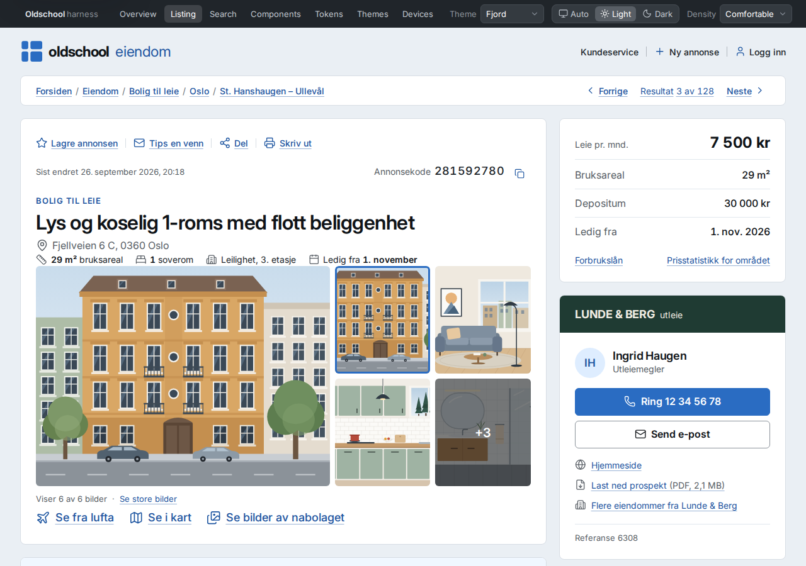
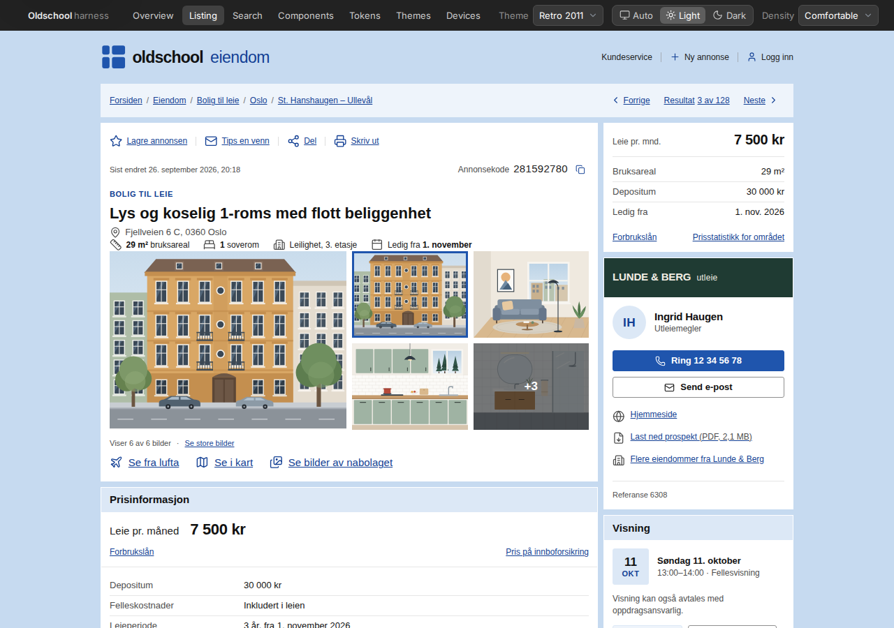
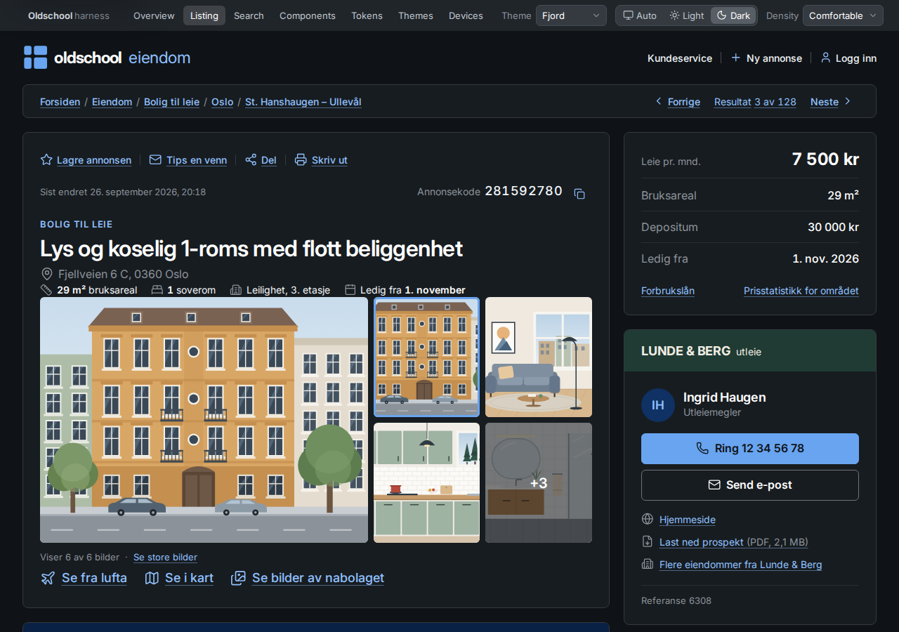
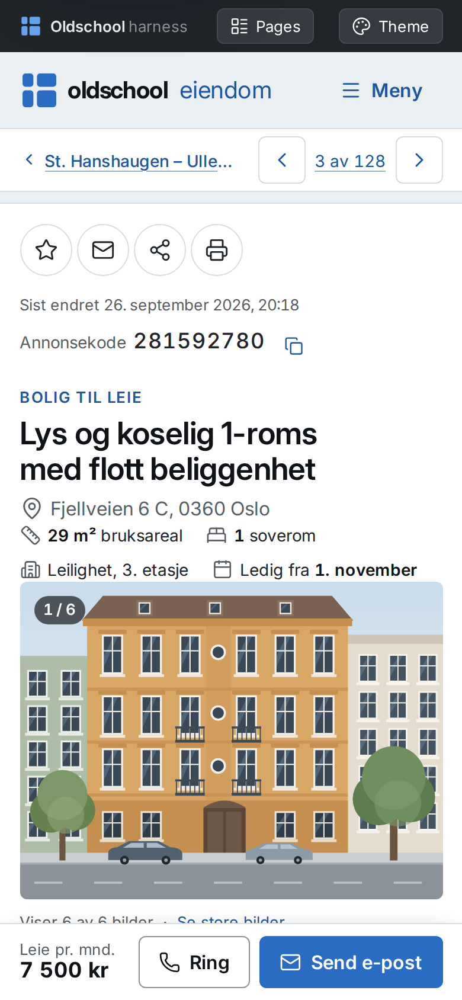

# Oldschool

**A practical, Nordic design harness.** The readability of 2000s Scandinavian
web pages — information first, boxes on a calm canvas, real underlined links,
facts you can scan — rebuilt with modern CSS, design tokens and Nordic
restraint. Built as a reference repo that other projects copy from.



| Same markup, 2011 (`data-theme="retro"`) | Dark mode | Phone |
|---|---|---|
|  |  |  |

## What's inside

- **Design tokens** generated from a single source (`tokens/*.mjs`) → CSS custom
  properties, resolved JSON, Tailwind v3/v4 bridges and a markdown reference.
- **8 color schemes × light/dark** — Fjord, Furu, Lyng, Nordlys, Bjørk,
  Tyttebær, Retro 2011, Kontrast. Ramps are generated in OKLCH with fixed
  lightness per step, so every theme has the same contrast behaviour.
  Themes can be scoped to any element. A **generator** makes new ones.
- **45+ components** in plain HTML + CSS (`.os-*`, BEM), cascade layers,
  container queries, no build step needed to use them.
- **Mobile patterns**: edge-to-edge sheets, sticky contact bar, collapsing
  breadcrumbs, swipe gallery, filter sheet — all without JavaScript
  (popover API, scroll-snap, `<details>`, `<dialog>`).
- **Small JS layer** (~8 kB gz, optional): gallery + lightbox, tabs, toggles,
  toasts, share/copy/print, theme persistence.
- **Compact density**, **print stylesheet**, **forced-colors** support.
- **Quality gates**: contrast of 37 role pairs in all 16 theme/mode
  combinations, token/class/HTML integrity, axe-core audits and interaction
  smoke tests in a real browser, CI workflow.
- **Showcase site** (`site/`): the listing page from the screenshot, a search
  page, component catalogue with copy-ready markup, live token reference,
  theme gallery + generator, and a desktop/tablet/phone preview.

Everything is dependency-free at runtime: ~20 kB CSS gzipped, self-hosted
Inter font, Lucide icon sprite.

## Quick start

```bash
npm run dev        # http://localhost:5180/site/ — rebuilds and live-reloads
```

Use it in any page:

```html
<html lang="nb" data-theme="fjord">
<head>
  <link rel="stylesheet" href="oldschool/dist/oldschool.css">
  <script src="oldschool/dist/oldschool.js" defer></script>
</head>
<body class="os-page">
  <section class="os-panel">
    <header class="os-panel__header"><h2 class="os-panel__title">Fakta om boligen</h2></header>
    <div class="os-panel__body">
      <dl class="os-kv">
        <div><dt>Boligtype</dt><dd>Leilighet</dd></div>
        <div><dt>Soverom</dt><dd>1</dd></div>
      </dl>
    </div>
  </section>
</body>
</html>
```

Switch theme, mode and density with attributes on `<html>` or any element:

```html
<html data-theme="furu" data-mode="dark" data-density="compact">
<section data-theme="retro"> …a 2011 island… </section>
```

## Using it in another repo

| You have… | Use |
|---|---|
| Plain HTML / any server framework | `dist/oldschool.css` + `dist/oldschool.js` + `dist/icons.svg` + `dist/fonts/` |
| A bundler | `npm i github:Zyvox/oldschool-no` → `import 'oldschool-no/css'`, `import { toast } from 'oldschool-no'` |
| Tailwind v4 | `@import "oldschool-no/dist/oldschool.css"; @import "oldschool-no/dist/tailwind.css";` → `bg-surface text-fg-muted border-line` |
| Tailwind v3 | `presets: [require('oldschool-no/dist/tailwind-preset.cjs')]` |
| React / Vue / Svelte | Components are markup + classes; see [docs/adoption.md](docs/adoption.md) for wrapper examples |
| Native / Figma / email | `dist/tokens.json` — every theme × mode fully resolved to hex |
| An AI agent | Point it at [`DESIGN.md`](DESIGN.md) and [`AGENTS.md`](AGENTS.md) |

## Documentation

| | |
|---|---|
| [DESIGN.md](DESIGN.md) | The design spec: principles, anatomy, colour, type, components, do/don't |
| [docs/tokens.md](docs/tokens.md) | Every token with values (generated) |
| [docs/theming.md](docs/theming.md) | How themes, modes, density and scoping work; making a theme |
| [docs/layout.md](docs/layout.md) | Page shell, grid, breakpoints and mobile patterns |
| [docs/components.md](docs/components.md) | Component reference: markup, variants, behaviour, a11y |
| [docs/javascript.md](docs/javascript.md) | The behaviors and their data attributes |
| [docs/accessibility.md](docs/accessibility.md) | What is guaranteed and how it is tested |
| [docs/adoption.md](docs/adoption.md) | Integrating with other stacks |

## Repository layout

```
tokens/            source of truth: palette.mjs, foundation.mjs, semantic.mjs, themes.mjs
src/css/           oldschool.css entry → tokens/ (generated), base/, layout/, components/, utilities/
src/js/            ES modules: core, theme, gallery, lightbox, tabs, actions, toast, color (OKLCH engine)
src/icons/         Lucide SVGs (ISC) → dist/icons.svg
src/fonts/         Inter Variable (OFL)
dist/              built CSS/JS/sprite/fonts/tokens — committed, ready to copy
site/              the showcase (open site/index.html via the dev server)
scripts/           build, serve, check, a11y, smoke, screenshots — zero-dependency except Playwright
docs/              guides
```

## Commands

| Command | What it does |
|---|---|
| `npm run build` | Tokens → CSS/JSON/Tailwind/docs, bundle CSS + JS, icon sprite |
| `npm run dev` | Dev server with rebuild and live reload |
| `npm test` | Build + static checks (contrast, tokens, classes, HTML, freshness) |
| `npm run smoke` | Browser interaction tests (needs `npm install`) |
| `npm run a11y` | axe-core audit, 7 pages × 6 theme/mode/viewport variants |
| `npm run screenshots` | Regenerate the images in `screenshots/` |

Build and checks need only Node ≥ 18. Browser tests need Playwright's
Chromium (`npx playwright install chromium`).

## Browser support

Full experience in browsers from 2024 on (Chrome/Edge 123+, Safari 17.5+,
Firefox 125+): `light-dark()`, `@layer`, container queries, `:has()`,
popover. Older browsers get light mode and inline (non-popover) menus; layout
and content still work.

## Credits

- Inter typeface by Rasmus Andersson — SIL Open Font License 1.1
- Lucide icons — ISC License
- Illustrations drawn for this project (`site/assets/img`), MIT like the rest
- Structural inspiration: Norwegian classifieds of the late 2000s. The demo
  brand, agency, people and listings are fictional.

MIT licensed. See [LICENSE](LICENSE).
