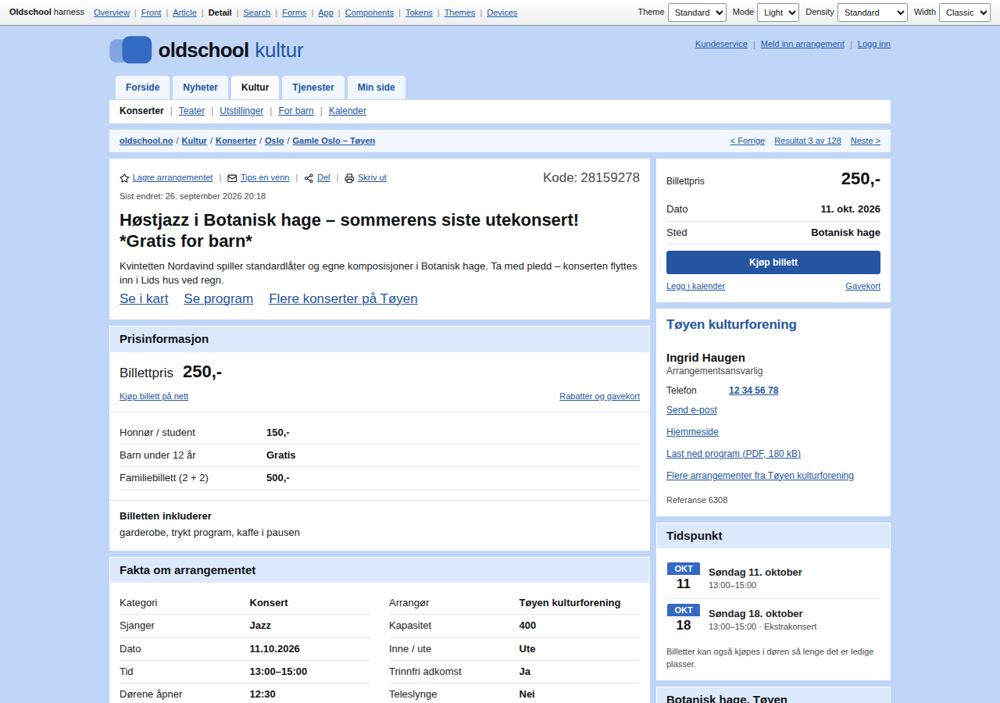
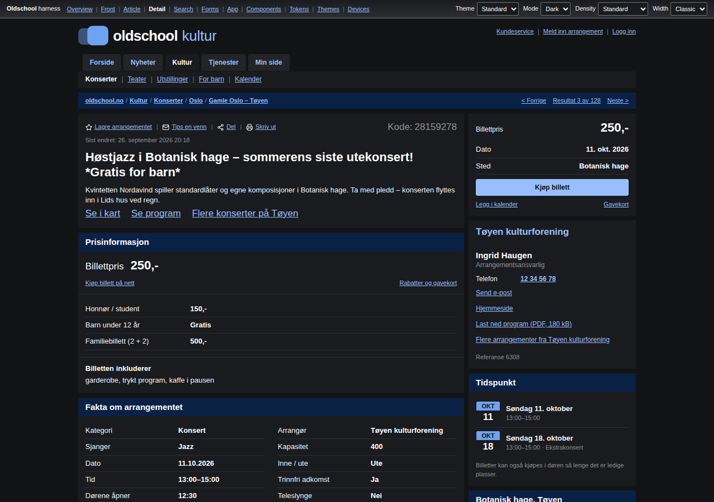
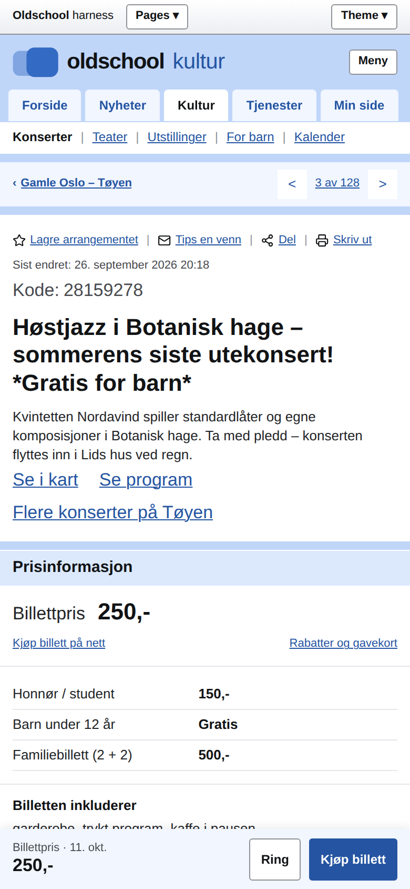
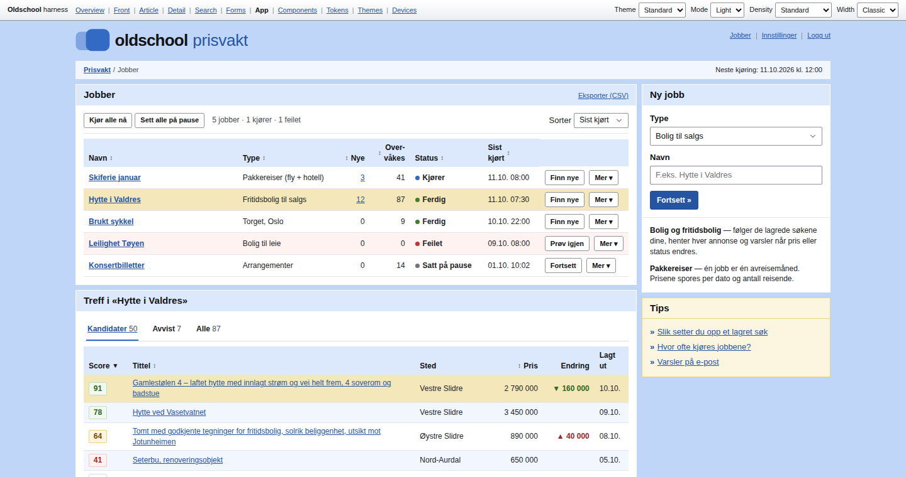
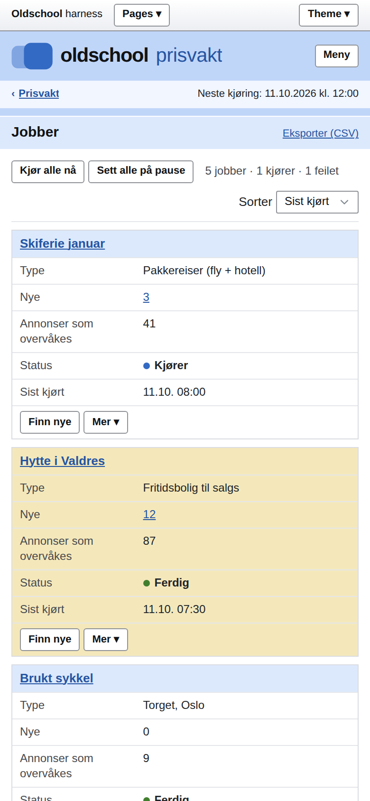
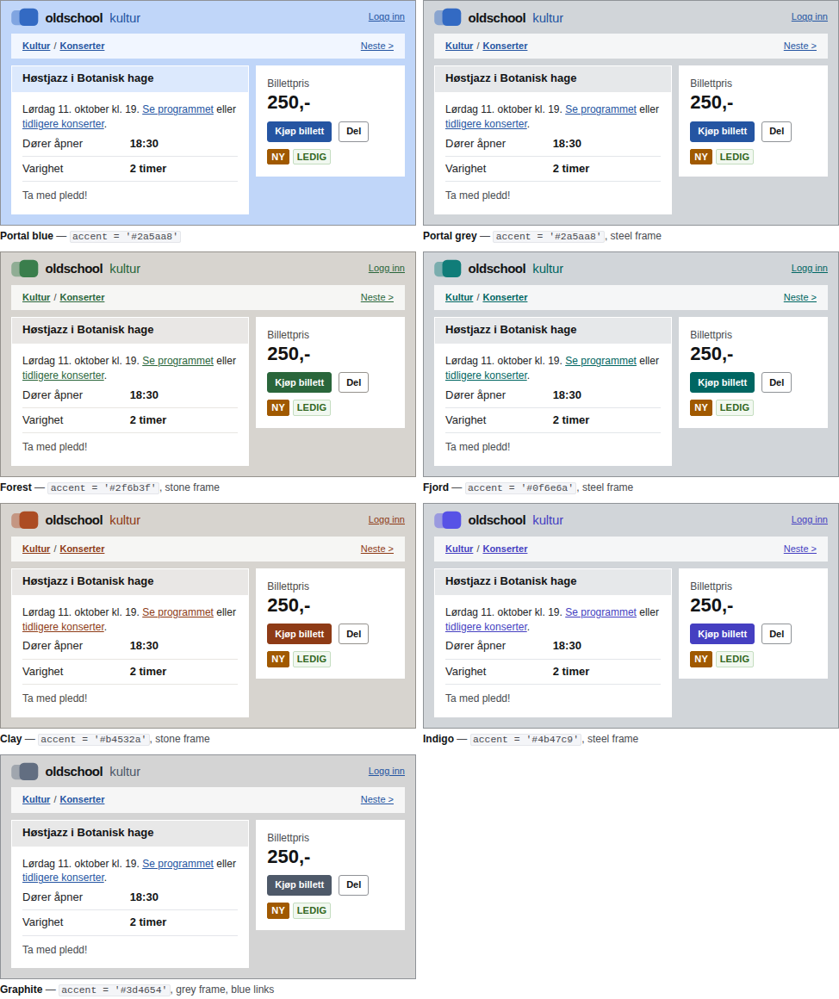
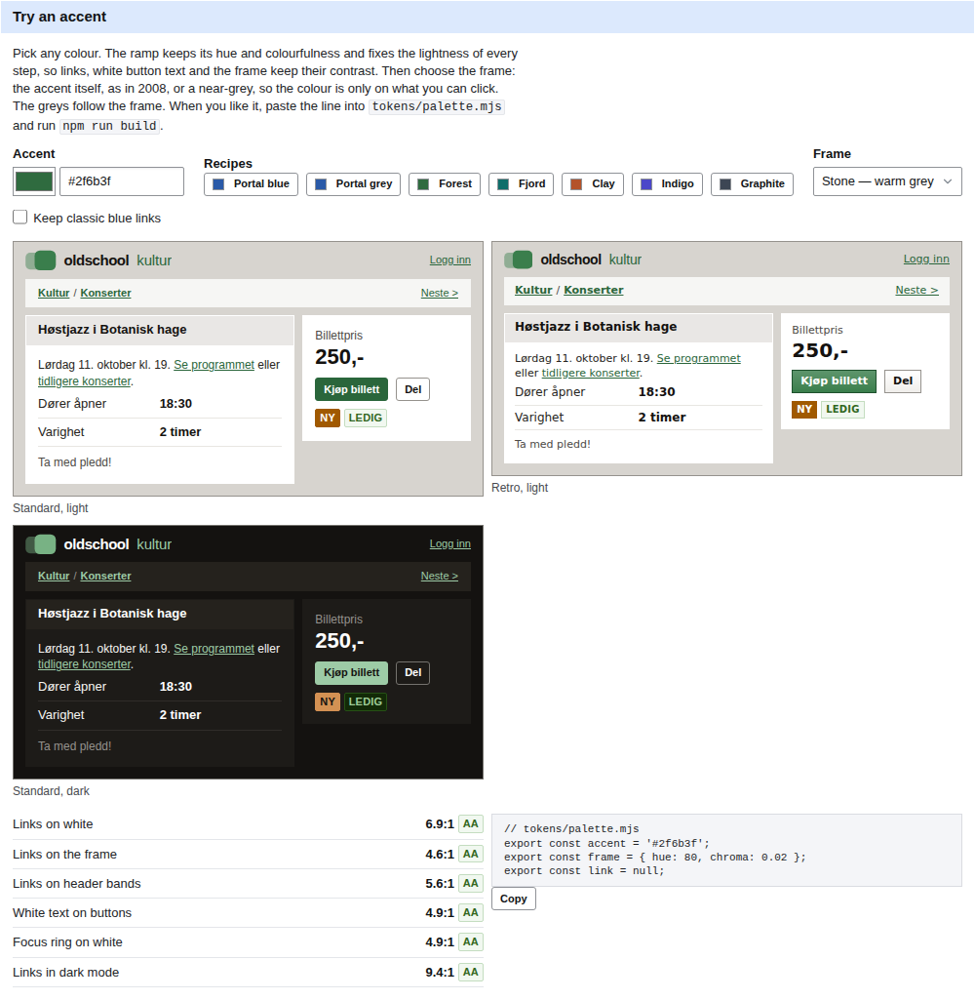

# Oldschool

**The 2008 Scandinavian web, brought back.** A design harness — tokens, CSS
components, a little optional JavaScript and a showcase site — for building
pages that look and work like the practical Norwegian portals, classifieds and
municipality sites of the late 2000s: a tinted frame around white boxes, header
bands, bold breadcrumbs, underlined blue links, facts as *label : value*.

The design is kept as it was. What changed is what dated it: the palette is
generated and contrast-checked, targets are 24px, it works on phones and in
dark mode, and the code underneath is modern CSS with no dependencies.



| Retro theme | Dark mode | Phone |
| --- | --- | --- |
|  |  |  |

| An app page on the wide frame | The same table on a phone |
| --- | --- |
|  |  |

## Theme colours

Every colour grows from **one seed**. To re-brand a clone, change a line or
two and rebuild:

```js
// tokens/palette.mjs
export const accent = '#2f6b3f';                 // any hex — its hue and colourfulness are kept
export const frame = { hue: 80, chroma: 0.02 };  // optional: a neutral frame (null = the accent, as in 2008)
export const link = null;                        // optional: '#2a5aa8' keeps classic blue links
```

```sh
npm run build && npm test          # regenerates the CSS, re-checks every contrast pair
```

The build fixes the lightness of every ramp step, so links, white button text
and the frame keep WCAG AA contrast whatever colour you pick — and `npm test`
fails if a seed ever breaks a pair.

Portal blue is the 2008 look: the frame and header bands are the accent, so
the site is blue all over. Portal grey is the same blue on a grey frame. The
other recipes are the modern look too: the frame
and bands are a near-grey (`frame`), and the colour sits only on buttons,
links and focus.



| Recipe | `accent` | `frame` | `link` |
| --- | --- | --- | --- |
| Portal blue (default) | `'#2a5aa8'` | `null` | `null` |
| Portal grey | `'#2a5aa8'` | `{ hue: 250, chroma: 0.02 }` (steel) | `null` |
| Forest | `'#2f6b3f'` | `{ hue: 80, chroma: 0.02 }` (stone) | `null` |
| Fjord | `'#0f6e6a'` | `{ hue: 250, chroma: 0.02 }` (steel) | `null` |
| Clay | `'#b4532a'` | `{ hue: 80, chroma: 0.02 }` (stone) | `null` |
| Indigo | `'#4b47c9'` | `{ hue: 250, chroma: 0.02 }` (steel) | `null` |
| Graphite | `'#3d4654'` | `{ chroma: 0 }` (grey) | `'#2a5aa8'` |

They live in `tokens/recipes.mjs`, and `npm test` checks every one of them too.

Try any colour and frame live on the themes page (`site/themes.html#h-accent`):
it previews both themes, prints the contrast ratios and gives you the lines to
paste.



How themes and colours are built, and how to add your own: [docs/theming.md](docs/theming.md).

## What's in it

- **Two themes**, both in light and dark mode:
  - **`standard`** (default) — the 2008 layout with today's controls: Arial
    13px, the saturated frame, square boxes, flat buttons with 3px corners,
    line tabs;
  - **`retro`** — the 2008 portal all the way: Verdana 12px, 24px square
    controls, bevelled gradient buttons.
- **One accent seed** in `tokens/palette.mjs` → every ramp, generated in OKLCH
  with fixed lightness per step; an optional neutral frame for a modern look.
  `prefers-contrast: more` is honoured.
- **Three densities** (`compact`, `standard`, `comfortable`) and **two widths**
  (the classic 1000px page, or 1200px with `.os-container--wide`).
- **63 components** as plain HTML + `os-` classes: page chrome (masthead, tab
  bar, crumb bar, pager, side menu, A–Å index, mobile bar), content (boxes,
  facts, key figures, link lists, teasers, tag cloud, tables, poll bars,
  calendar, log, forum thread, files, picture carousel) and controls (buttons, forms, error
  summary, search, filters, tabs, menus, status, scores, toasts, notifications, dialogs). Everything works
  without JavaScript.
- **Modern by default, retro on request**: flat buttons (solid primary,
  white secondary, borderless `--ghost`) and line tabs; the 2008 bevelled
  button with `.os-button--retro` or `data-buttons="retro"` (automatic in the
  retro theme), folder tabs with `.os-tabs--folder`.
- **Tables for apps**: cells centred vertically, an actions column that stays
  on one line (and sticks to the right edge with `--sticky`), a "Mer ▾" menu
  per row, capped cell widths, thumbnails, row states, scores, status dots,
  link tabs for server-rendered views — and `.os-table--stack`, which turns
  rows into small label/value boxes on narrow screens instead of scrolling.
- **Small optional JS** for tabs, sortable and stacked tables, menu placement, the
  carousel, dialogs, toggles, copy/share/print, toasts, notifications and the theme switch.
- **Token exports**: `dist/tokens.json` (every value, resolved), a Tailwind v4
  bridge and a v3 preset.
- **Showcase site** (`site/`, Norwegian demo pages): front page, article,
  detail page, search, self-service form, an app dashboard, plus component,
  token and theme references and a desktop/tablet/phone preview.

## Size

Everything is hand-written CSS in cascade layers; no framework, no web fonts,
no images.

| File | Minified | gzip |
| --- | --- | --- |
| `dist/oldschool.min.css` — tokens, both themes, all 63 components | 93 kB | **16 kB** |
| `dist/oldschool.min.js` — optional behaviors | 21 kB | **7 kB** |
| `dist/icons.svg` — optional sprite, 123 Lucide icons | 25 kB | 6 kB |

## Quick start

```html
<!doctype html>
<html lang="nb">                    <!-- standard by default; data-theme="retro" for the full 2008 look -->
<head>
  <meta name="viewport" content="width=device-width, initial-scale=1">
  <link rel="stylesheet" href="oldschool/dist/oldschool.min.css">
  <script src="oldschool/dist/oldschool.min.js" defer></script>
</head>
<body class="os-page">
  <div class="os-container">
    <header class="os-masthead">…</header>
    <main class="os-layout">
      <div class="os-layout__main">
        <section class="os-panel" aria-labelledby="fakta">
          <header class="os-panel__header"><h2 class="os-panel__title" id="fakta">Fakta</h2></header>
          <div class="os-panel__body">
            <dl class="os-kv"><div><dt>Dato</dt><dd>11.10.2026</dd></div></dl>
          </div>
        </section>
      </div>
      <aside class="os-layout__aside">…</aside>
    </main>
  </div>
</body>
</html>
```

Run the showcase locally: `npm run dev` → <http://localhost:5180/site/>.

## Using it in another project

| Stack | Use |
| --- | --- |
| Plain HTML / any server framework | `dist/oldschool.min.css` + `dist/oldschool.min.js` + `dist/icons.svg` |
| Bundlers (Vite, webpack, …) | `import 'oldschool-no/css/min'` and `import { toast } from 'oldschool-no'` |
| Tailwind v4 | `@import "oldschool-no/dist/oldschool.css"; @import "oldschool-no/dist/tailwind.css";` → `bg-surface text-fg-muted border-line` |
| Tailwind v3 | `presets: [require('oldschool-no/dist/tailwind-preset.cjs')]` |
| Native, email, anything else | values from `dist/tokens.json`, rules from [DESIGN.md](DESIGN.md) |

Your own colours: fork or copy the repo, change `tokens/palette.mjs`, run
`npm run build`, and use your `dist/`. Details in [docs/adoption.md](docs/adoption.md).

## Documentation

- [DESIGN.md](DESIGN.md) — the spec: principles, page anatomy, rules
- [docs/theming.md](docs/theming.md) — seeds, ramps, themes, densities, adding your own
- [docs/components.md](docs/components.md) — markup for every component (generated)
- [docs/tokens.md](docs/tokens.md) — every token and value (generated)
- [docs/layout.md](docs/layout.md) — page shell, columns, widths, mobile
- [docs/javascript.md](docs/javascript.md) — the optional behaviors
- [docs/accessibility.md](docs/accessibility.md) — what is guaranteed and how it is tested
- [docs/adoption.md](docs/adoption.md) — using Oldschool in another repo
- [AGENTS.md](AGENTS.md) — instructions for AI coding agents

## Repository layout

```
tokens/        source of truth: palette.mjs (seeds), foundation.mjs, semantic.mjs, themes.mjs, recipes.mjs
src/css/       oldschool.css entry → tokens/ (generated), base/, layout/, components/, utilities/
src/js/        ES modules: core, theme, tabs, sort, actions, toast, color (OKLCH engine)
src/icons/     Lucide SVGs → dist/icons.svg
dist/          built CSS/JS/sprite/tokens — committed, ready to copy
site/          the showcase (open site/index.html or run npm run dev)
scripts/       build, dev server, checks, smoke tests, a11y audit, screenshots
docs/          guides (tokens.md and components.md are generated)
```

## Scripts

| Command | What it does |
| --- | --- |
| `npm run build` | tokens → CSS, bundle + minify CSS and JS, sprite, token exports, generated docs |
| `npm run dev` | dev server on :5180 with live reload |
| `npm test` | build + static checks: contrast for every pair in both themes, modes and contrast preferences; token and class integrity; HTML hygiene; generated files fresh |
| `npm run smoke` | interaction tests in Chromium (needs `npm install`) |
| `npm run a11y` | axe-core WCAG 2.2 AA audit of every page in 8 variants |
| `npm run screenshots` | regenerates `screenshots/` |

The build and checks need only Node ≥ 18.17; the browser tests use Playwright.

## Credits

- Icons: [Lucide](https://lucide.dev) — ISC License.
- Fonts: none bundled — Verdana and Arial from the system, as in 2008.
- All people, organisations, events and listings in the demos are fictional.

MIT License.
