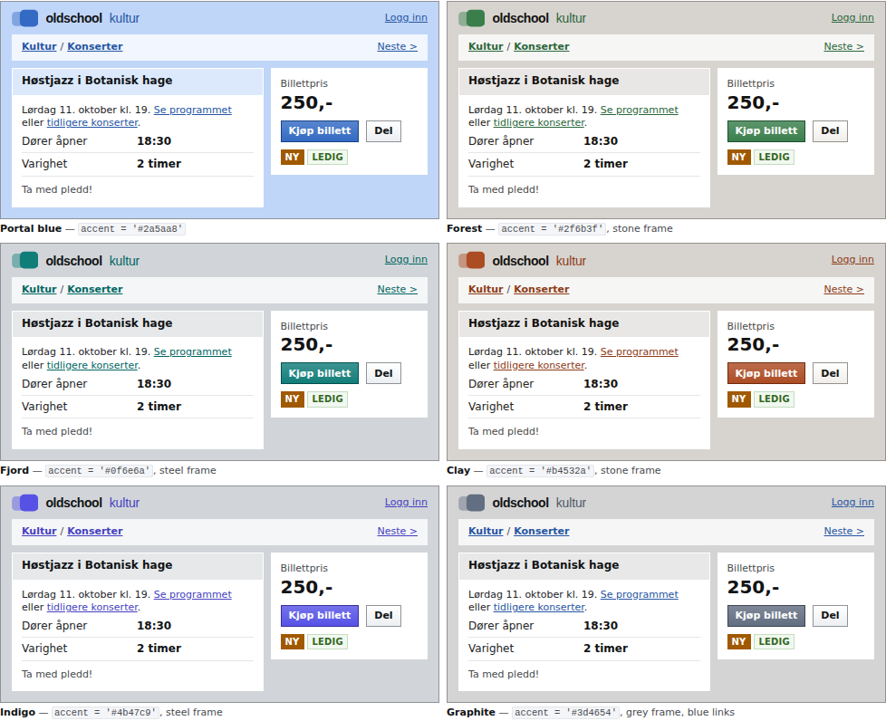

# Theming

Oldschool separates four independent choices. Each is an attribute you can put
on `<html>` — or on any element, to change just that subtree.

| Attribute | Values | Decides |
| --- | --- | --- |
| `data-theme` | `retro` (default) · `standard` | the look: type, spacing, corners, which shade goes where |
| `data-mode` | `auto` (default) · `light` · `dark` | light or dark; `auto` follows the OS |
| `data-density` | `compact` · `standard` (default) · `comfortable` | text size, row and box padding, control heights |
| `data-width` | `classic` (default) · `wide` | page width: 1000px or 1200px (also `.os-container--wide`) |

**Colour is not a theme.** It comes from one seed in `tokens/palette.mjs` (plus
an optional frame colour) and is shared by both themes. Re-branding is a build-time change in your clone, not
extra CSS shipped to every visitor.

```html
<html lang="nb" data-theme="standard" data-mode="auto">
<section class="os-panel" data-theme="retro"> … one retro box on a standard page … </section>
```

## Contents

- [How it is built](#how-it-is-built)
- [Changing the colours](#changing-the-colours)
- [The two themes](#the-two-themes)
- [Changing a theme](#changing-a-theme)
- [Adding a theme](#adding-a-theme)
- [Densities and widths](#densities-and-widths)
- [Light and dark](#light-and-dark)
- [More contrast](#more-contrast)
- [Runtime preferences](#runtime-preferences)
- [Overriding without a build](#overriding-without-a-build)

## How it is built

```
tokens/palette.mjs     seeds ───────────────┐  accent '#2a5aa8', frame?, neutral tint, link?, visited, status
                                            ▼
src/js/color.js        seed → ramp          accent-50 … accent-950, frame-*, neutral-0 … neutral-1000, …
                                            ▼
tokens/semantic.mjs    what a colour is for --os-color-link = accent.700 (light) / accent.300 (dark)
tokens/foundation.mjs  sizes and roles      --os-pad, --os-radius-panel, --os-text-md, …
                                            ▼
tokens/themes.mjs      the two looks        retro: canvas = frame.200, text-md = 12px, radius 0 …
                                            ▼
scripts/build.mjs      → src/css/tokens/*.css → dist/oldschool.css (+ .min.css)
                       → dist/tokens.json, Tailwind bridges, docs/tokens.md
scripts/check.mjs      every text/background pair × theme × mode × contrast preference ≥ WCAG AA,
                       for the palette and every recipe in tokens/recipes.mjs
```

Five generated files make up the token layer (never edit them by hand):

| File | Contains |
| --- | --- |
| `src/css/tokens/palette.css` | the ramps as `--os-accent-*`, `--os-neutral-*`, and the frame, link and status steps in use, on `:root` |
| `src/css/tokens/foundation.css` | primitive scales (`--os-space-4`, `--os-text-md` …) and role tokens (`--os-pad`, `--os-radius-panel` …) |
| `src/css/tokens/semantic.css` | `--os-color-*`, each a `light-dark()` pair of ramp steps |
| `src/css/tokens/themes.css` | one block per theme with its overrides, plus the `prefers-contrast: more` block |
| `src/css/tokens/density.css` | one block per density |

Components only ever use semantic colours (`--os-color-link`) and role tokens
(`--os-pad`). That is what lets a theme or a seed change everything at once.

### Ramps

`src/js/color.js` turns a seed into a ramp. Lightness per step is fixed (in
OKLCH, where lightness is perceptually even), and chroma follows a curve that
peaks at steps 500–600:

| Step | 50 | 100 | 200 | 300 | 400 | 500 | 600 | 700 | 800 | 900 | 950 |
| --- | --- | --- | --- | --- | --- | --- | --- | --- | --- | --- | --- |
| OKLCH L | .972 | .93 | .87 | .80 | .71 | .62 | .535 | .46 | .39 | .32 | .255 |
| Used for | tints | bands | retro frame | dark links | | | buttons, focus | links | hover | | dark bands |

Because the lightness is the same for every hue, step 700 of *any* accent is
safe for link text on white, step 600 always carries white button text, and
so on. A hex seed keeps its hue; its chroma is scaled up to the ramp's peak
from the step whose lightness is nearest, so `#2a5aa8` and a pale tint of the
same blue give the same ramp. Colours outside sRGB are pulled in by reducing
chroma, never lightness.

Neutrals use the frame's hue — the accent's, unless a frame seed is set — at a
low chroma (`neutral.chroma`, default `0.008`), so the greys lean slightly
towards it. Steps run from `0` (white) to `1000` (near-black).

## Changing the colours

Edit `tokens/palette.mjs` and run `npm run build && npm test`.

```js
export const accent = '#2f6b3f';         // the brand colour
export const frame = { hue: 80, chroma: 0.02 }; // null = the frame is the accent (the 2008 look)
export const neutral = { chroma: 0.008 };// 0 = pure grey; give `hue` to tint elsewhere
export const link = null;                // or a seed, e.g. '#2a5aa8' for classic blue links
export const visited = { hue: 305, chroma: 0.12, hueShift: -6 };
export const status = { success: …, warning: …, danger: …, info: …, note: … };
```

A seed is either a hex string or `{ hue, chroma, hueShift? }`:

- `hue` — OKLCH hue in degrees (0 red · 60 orange · 100 yellow · 140 green · 200 teal · 255 blue · 305 violet);
- `chroma` — peak colourfulness (≈0.04 muted … 0.13 the default blue … 0.2 vivid);
- `hueShift` — degrees the hue drifts from the light end (+) to the dark end (−),
  for warmer tints and deeper shades.

Pick a **mid-tone** — a button colour, not a background tint. Then check:

- `npm test` fails with the exact pair and ratio if a seed breaks contrast
  (very light or very yellow seeds can push `accent.600` too light for white
  text; lower the chroma or move the hue);
- the [themes page](../site/themes.html#h-accent) previews any colour in both
  themes, shows the key ratios and gives you the line to paste.

**The frame.** By default the frame, header bands, crumb bar, inactive tabs
and zebra rows come from the accent too — a blue site is blue all over, as in
2008. Set `frame` to a near-grey seed for the modern look: neutral frame and
bands, and the accent only on what you can click (buttons, links, focus,
selected states). `{ hue: 80, chroma: 0.02 }` is a warm stone,
`{ hue: 250, chroma: 0.02 }` a cool steel, `{ chroma: 0 }` plain grey; leave
out `hue` to lean towards the accent. The frame ramp has the same fixed
lightness steps, so contrast does not depend on it; the greys follow its hue.

**Links.** Many sites of the era kept blue links whatever their brand colour.
For a green, orange or grey accent, set `link` to a blue seed: the build then
emits `--os-link-*` steps and points `--os-color-link` at them.

### Recipes

Defined in `tokens/recipes.mjs`, shown on the
[themes page](../site/themes.html#h-recipes) and checked by `npm test` like the
palette itself, so each is safe to paste.

| Look | `accent` | `frame` | `link` |
| --- | --- | --- | --- |
| Portal blue (default) — the 2008 look | `'#2a5aa8'` | `null` | `null` |
| Forest | `'#2f6b3f'` | `{ hue: 80, chroma: 0.02 }` (stone) | `null` |
| Fjord | `'#0f6e6a'` | `{ hue: 250, chroma: 0.02 }` (steel) | `null` |
| Clay | `'#b4532a'` | `{ hue: 80, chroma: 0.02 }` (stone) | `null` |
| Indigo | `'#4b47c9'` | `{ hue: 250, chroma: 0.02 }` (steel) | `null` |
| Graphite | `'#3d4654'` | `{ chroma: 0 }` (grey) | `'#2a5aa8'` |



## The two themes

A theme is a list of overrides on top of the base tokens. The base values in
`tokens/foundation.mjs` and `tokens/semantic.mjs` *are* the standard theme;
`retro` overrides these:

| Token | Standard (base) | Retro |
| --- | --- | --- |
| `--os-font-body` | Arial | Verdana |
| `--os-text-md` (body) … scale | 14px, 13, 12 … 36 | 12px, 11, 11 … 28 |
| `--os-gap` / `--os-pad` | 10px / 12px | 8px / 10px |
| `--os-row-pad` | 5px | 4px |
| radii | 3px panels and controls, 4px tabs | 0 |
| `--os-control-height` | 30px | 24px (the WCAG 2.2 minimum) |
| `--os-bevel` | one-pixel white highlight | none |
| `--os-color-canvas` (frame) | `frame.100` | `frame.200` — the saturated frame |
| `--os-color-panel-border` | `frame.200` hairline | none |
| `--os-color-text-muted` | `neutral.600` | `neutral.700` (smaller text needs more contrast) |

The default theme also applies when no `data-theme` is set. In the generated
CSS it claims `:root`; `[data-theme="standard"]` comes later in the file with
the same specificity, so it wins on `<html data-theme="standard">`. Every key
that *any* theme overrides is declared by *every* theme, so a standard box
inside a retro page never inherits retro's overrides.

## Changing a theme

To change what a theme looks like, edit its entry in `tokens/themes.mjs`:

```js
retro: {
  label: 'Retro',
  description: '…',
  primitives: { 'text-md': '0.75rem', … },     // foundation primitives (type scale etc.)
  roles: { 'radius-panel': '0', gap: '0.5rem', … },  // role tokens, may use {group.key} refs
  colors: { canvas: { light: 'frame.200', dark: 'neutral.1000' }, … },  // semantic colours
},
```

- **primitives** — keys of `tokens/foundation.mjs` scales as `group-key`
  (`text-md`, `space-4`, `radius-sm`).
- **roles** — keys of `foundation.roles` (`pad`, `font-body`, `control-height` …).
  Values may reference primitives: `'{font.verdana}'`, `'{radius.sm}'`.
- **colors** — keys of `tokens/semantic.mjs`, each `{ light, dark }` with
  references like `accent.700`, `neutral.0`, `link.300`, `success.600`,
  `mix(neutral.1000 8%)` (with alpha), `=text-strong` (alias) or a literal
  (`transparent`).

To change something for **both** themes, edit the base in
`tokens/foundation.mjs` or `tokens/semantic.mjs` instead (and remove the
override from `retro` if it should follow).

## Adding a theme

1. Add an entry to `themes` in `tokens/themes.mjs` with the overrides it needs:

   ```js
   avis: {
     label: 'Avis',
     description: 'Newspaper: Georgia headings, white frame, ruled boxes.',
     roles: { 'font-heading': '{font.serif}', 'radius-panel': '0' },
     colors: {
       canvas: { light: 'neutral.0', dark: 'neutral.1000' },
       'panel-border': { light: 'neutral.300', dark: 'neutral.800' },
     },
   },
   ```

2. `npm run build && npm test`. The contrast check now covers the new theme in
   light, dark and more-contrast; it fails if any pair drops below AA.
3. It appears in the harness theme menu, on the themes and tokens pages and in
   `dist/tokens.json` automatically. Add it to the variants in
   `scripts/a11y.mjs` if you want axe to audit it too.

To make it the default, set `defaultTheme` in `tokens/themes.mjs` (and
`DEFAULTS.theme` in `src/js/theme.js`).

## Densities and widths

Densities live in `tokens/foundation.mjs` → `densities`. Each re-points a few
role tokens; values are absolute, so they behave the same under both themes
(compact drops body text one step of the active theme's scale: 11px Verdana in
retro, 13px Arial in standard).

```js
compact: { description: '…', values: { 'text-body': '{text.sm}', gap: '0.5rem', 'control-height': '1.5rem', … } },
```

Width is a single role token, `--os-container-width`: 1000px by default, 1200px
on `.os-container--wide` or under `[data-width="wide"]`. Set it to anything:

```css
.my-dashboard { --os-container-width: 90rem; }
```

## Light and dark

Mode is a property of the inherited `color-scheme`, so every semantic colour is
written once:

```css
--os-color-link: light-dark(var(--os-accent-700), var(--os-accent-300));
```

`:root` follows the OS (`color-scheme: light dark`); `[data-mode="light"]` and
`[data-mode="dark"]` force one mode on any subtree. Browsers without
`light-dark()` (before 2024) are not supported.

## More contrast

When the visitor asks the OS for more contrast (`prefers-contrast: more`), the
`moreContrast` overrides in `tokens/themes.mjs` apply on top of either theme:
darker muted text, stronger rules, 2px link underlines, a 3px focus ring. They
are contrast-checked like the themes.

## Runtime preferences

`oldschool.js` exposes `Oldschool.theme.set({ theme, mode, density, width })`,
stores the choice in `localStorage["os-prefs"]`, syncs tabs and iframes and
fires `os:preferences`. Declarative controls:

```html
<select data-os-theme-control="theme"><option value="retro">Retro</option><option value="standard">Standard</option></select>
<select data-os-theme-control="mode">…auto | light | dark…</select>
```

Put this in `<head>` before the stylesheet to apply saved preferences without a
flash:

```html
<script>(function(){try{var p=JSON.parse(localStorage.getItem('os-prefs')||'{}'),d=document.documentElement;if(d.hasAttribute('data-os-lock'))return;if(p.theme)d.dataset.theme=p.theme;if(p.mode&&p.mode!=='auto')d.dataset.mode=p.mode;if(p.density&&p.density!=='standard')d.dataset.density=p.density;if(p.width&&p.width!=='classic')d.dataset.width=p.width}catch(e){}})()</script>
```

`data-os-lock` on `<html>` keeps a page on its own settings.

## Overriding without a build

If you consume the published `dist/` and cannot rebuild, override the ramps in
your own stylesheet (any CSS outside a layer beats Oldschool's layers). Generate
the values on the themes page or with `schemeFromSeeds()` from
`dist/esm/color.js`:

```css
:root, [data-theme] {
  --os-accent-50: #f0f8f1; --os-accent-100: #dcede0; /* … through 950 */
  --os-frame-50: …; --os-frame-100: …; --os-frame-200: …; --os-frame-900: …; --os-frame-950: …;
}
```

The frame steps are separate variables even when the frame is the accent, so
set both: the accent steps for buttons and links, the frame steps for the
frame and bands.

Semantic colours reference the ramps, so they follow — but you lose the
build-time contrast check, so prefer changing the seed in a clone.
